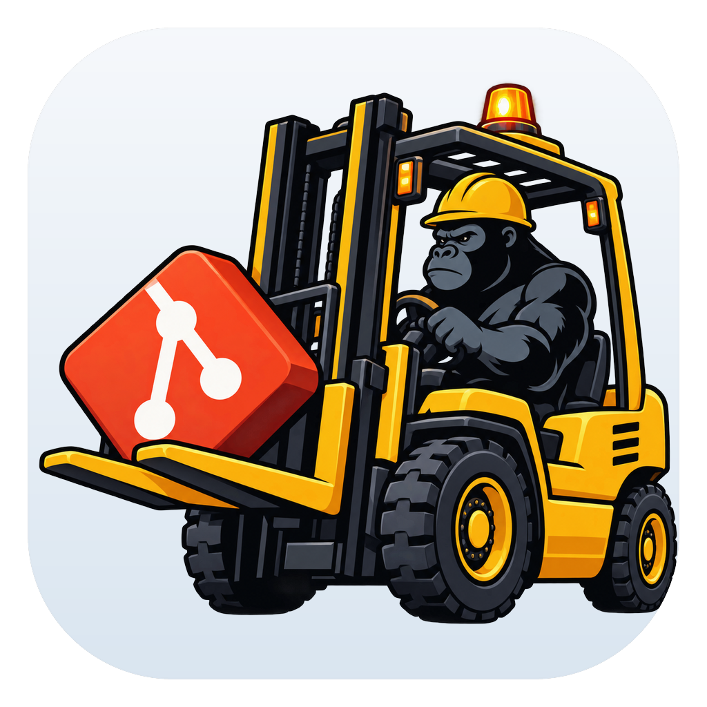
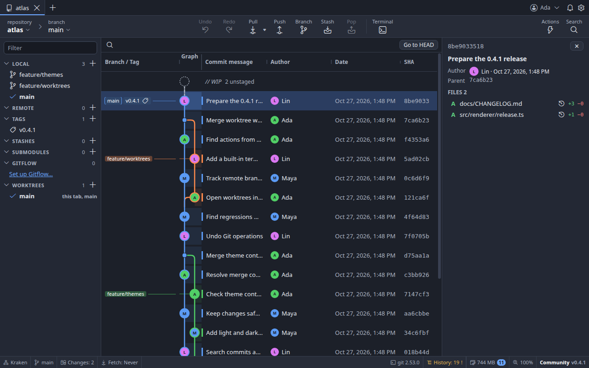
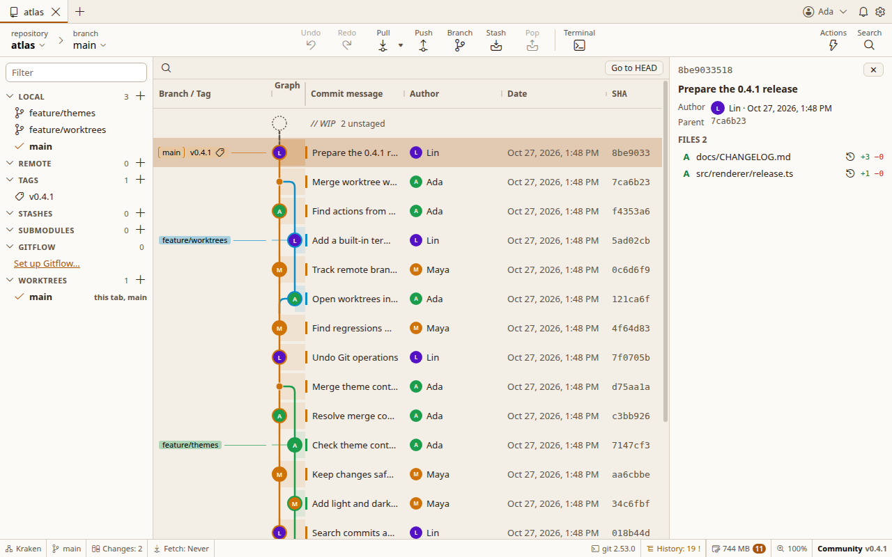
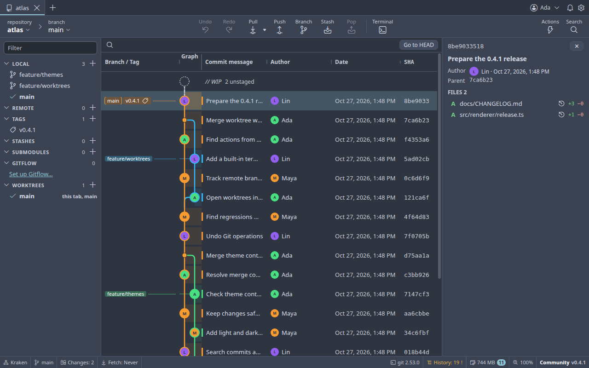
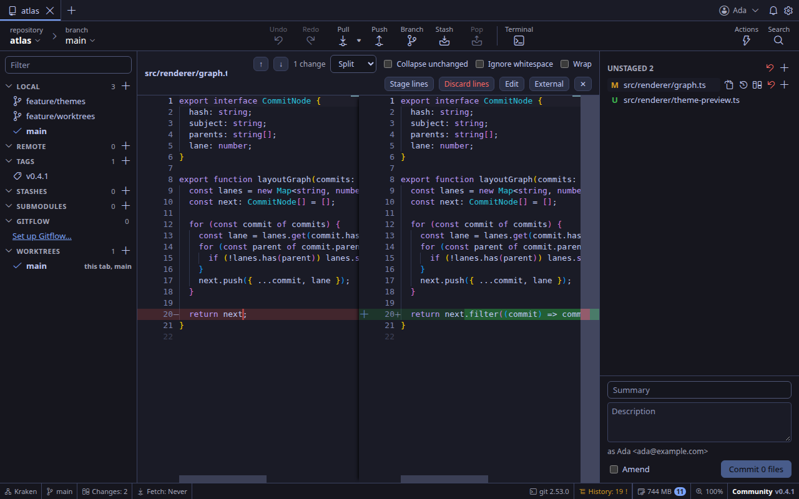

<div align="center">



# Forklift

<p><strong>English</strong> · <a href="README.ru.md">Русский</a></p>

**A desktop Git workspace for the whole journey from first diff to final release.**

Visual history · precise staging · safe operations · your choice of colors

[](https://github.com/forklift-dev/forklift/actions/workflows/build.yml)
[](https://github.com/forklift-dev/forklift/releases)
[](LICENSE)

[Download a build](https://github.com/forklift-dev/forklift/releases) · [Explore the documentation](docs/README.md) · [Build from source](#build-from-source)

</div>



Forklift brings the Git work you do every day into one window. Inspect a commit, stage a single line,
resolve a conflict, search history or track down a regression without losing your place in the graph.
Local repositories work without an account; remote and hosting features are there when you need them.

## See it in your colors

The same repository in three more built-in themes. Forklift has **20 built-in themes**, custom theme files,
accent colors, **seven graph styles** and adjustable panel and column widths.

| Dawn · light | Fjord · cool dark |
|:---:|:---:|
|  |  |



*Neon Night: a built-in split diff with syntax highlighting and line-level actions.*

## Why Forklift

- **See the whole story.** A virtualized commit graph shows branches, tags, authors and the working tree together. Search by message, author, hash, file or content, then jump straight to the match.
- **Choose exactly what goes into a commit.** Review side-by-side, inline, hunk or whole-file diffs; stage and discard individual files, hunks and lines. Amend when the last commit needs another pass.
- **Handle the hard parts in the same workspace.** Merge, rebase, cherry-pick, revert, reset, interactive rebase and bisect are available alongside a visual three-way conflict editor. Bisect can step manually or run your test command and show its output.
- **Stay in control.** Supported operations have Undo/Redo, destructive actions ask for confirmation, and switching branches can stash and restore local changes. The operation log shows what Git ran and why it failed.
- **Work the way you prefer.** Use the command palette and configurable shortcuts, the built-in terminal, external editors and diff tools, or several repositories and worktrees in separate tabs. File watching keeps the view current while another program edits the repository.
- **Keep the basics local.** Opening, searching and editing a local repository needs no sign-in. Optional hosting connections add pull requests, issues and remote operations; credentials use the operating system's secure storage when available.
- **Ask for AI help when you want it.** In Preferences → Integrations, choose a downloaded Ollama model, your own OpenAI API key, or an installed Codex, Claude Code, OpenCode or Qwen Code CLI. Forklift asks before every request and warns when the provider may charge for tokens; suggestions never change files automatically.

## Get Forklift

Pre-release packages are published on the [Releases page](https://github.com/forklift-dev/forklift/releases) after the Linux, Windows and macOS builds succeed.

| Platform | Current package |
|---|---|
| Linux x64 | AppImage |
| Windows x64 | Installer and ZIP |
| macOS Apple silicon | DMG and ZIP |

These beta packages are not yet signed or notarized. Your operating system may ask for confirmation on first launch.

## Build from source

You need **Node.js 22.12 or newer** and a local toolchain for the native Git modules. The modules are built for the
same operating system and CPU architecture on which you run Forklift.

| Platform | Build tools |
|---|---|
| Linux | `build-essential`, `python3`, `perl`, `libkrb5-dev`; on Ubuntu 22.04, `clang-15` |
| macOS | Xcode Command Line Tools, `python3` |
| Windows | Visual Studio 2022 Build Tools (Desktop C++), `python3` |

```bash
npm ci
npm run dev
```

`npm ci` rebuilds the native modules for Electron 45. On Linux, OpenSSL 3 is built from source; on macOS and Windows,
the build script downloads a SHA-256-verified OpenSSL package. For installers, use `npm run dist` on the target machine.
On Ubuntu 22.04, run `npm ci` with `CC=clang-15 CXX=clang++-15` for Electron 45's V8 headers.

The repository also provides platform setup scripts:

```powershell
# Windows: install missing tools and build the installer and ZIP
powershell -ExecutionPolicy Bypass -File scripts\build-windows.ps1
```

```bash
# macOS: bootstrap Node if needed, rebuild modules and package DMG + ZIP
bash scripts/build-macos.sh
```

## Development

| Command | What it does |
|---|---|
| `npm run dev` | Launch the app with hot reload |
| `npm run build` | Build the Electron app into `out/` |
| `npm run typecheck` | Check main and renderer TypeScript |
| `npm run lint` | Check source and tests with oxlint |
| `npm test` | Run unit and integration tests in Electron's Node runtime |
| `npm run test:e2e` | Run the desktop end-to-end suites |
| `npm run dist` | Package for the current platform |
| `npm run rebuild:native` | Rebuild native modules after an Electron upgrade |

The README screenshots come from a disposable Git repository and an isolated app profile. Regenerate them after
building with `node scripts/capture-readme.mjs` (on headless Linux, use `xvfb-run -a node scripts/capture-readme.mjs`).

### Help translate Forklift

Interface translations are welcome. Start the visual translation table with `npm run translations:dev`; the [translation guide](docs/translating.md) explains how to add a language, export JSON, run checks, and send a pull request. Documentation translations are reviewed separately from interface catalogs.

### Architecture at a glance

```text
main process       Git services + the authoritative Redux store
       ↓           typed commands and state updates over IPC
preload            a narrow contextBridge API
       ↓
renderer           React UI with a read-only state replica
```

The renderer runs with context isolation, sandboxing and no Node integration. Git operations are serialized per
repository; native Git services and CLI commands run outside the renderer. The [architecture notes](docs/architecture.md)
explain the boundaries and trade-offs, and the [task index](docs/README.md) tracks what is implemented and what is planned.

## License and attribution

Forklift is licensed under [Apache License 2.0](LICENSE). You may use, modify and distribute the code and the app,
including in commercial projects, under its terms. Distributed derivatives must preserve the attribution in
[NOTICE](NOTICE), which names the original author and [source repository](https://github.com/forklift-dev/forklift).
Third-party material retains its own notices in [THIRD_PARTY_NOTICES.md](THIRD_PARTY_NOTICES.md).
